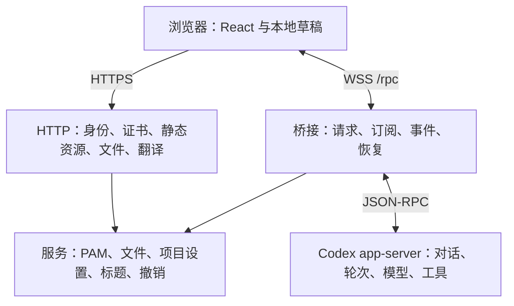
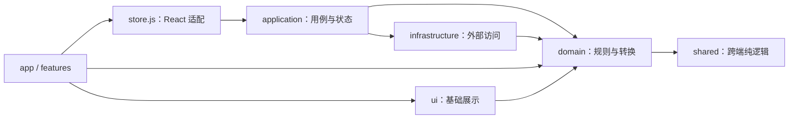
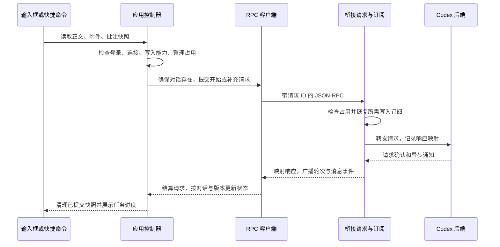

# Codex Web 架构设计

本文面向实现和审查 Codex Web 的开发者，描述仓库当前的模块边界、依赖规则、状态所有权、运行流程及演进方式。功能行为约束见[功能与状态契约](architecture/behavior.md)，环境、测试命令和发布操作见[开发者指南](development.md)。改变模块边界、状态归属、协议或构建方式时，同步更新本文及对应回归。

## 1. 系统边界

Codex Web 是已有 Codex app-server 的浏览器客户端。Codex 后端保存对话与轮次记录，执行模型调用、工具和交互式命令；网页桥接负责浏览器身份验证、多页面连接协调及网页专用服务；浏览器负责交互、展示和本地草稿。



生产网页与业务请求同源。浏览器统一使用 HTTPS/WSS；后端地址由配置解析，明文 WebSocket 限于回环地址，跨主机使用 WSS。会话凭据留在受保护的 Cookie 和服务器会话文件中，前端状态只保存会话结果。

三条持久化边界保持清晰：

- **Codex 后端**：对话、轮次、标题、模型任务与工具记录，是历史恢复的事实来源。
- **桥接数据目录**：项目模型选择、未分类目录索引、认证会话、维护凭据和证书，按 `CODEX_HOME` 下的职责目录保存；受限文件采用权限控制及原子写入。
- **浏览器存储**：输入与批注草稿、界面偏好、项目选择缓存和未结束整理任务的恢复线索。重新连接后以实际后端记录核对运行结果。

## 2. 源码组织与依赖方向

```text
client/src/
  main.jsx                 挂载 React 根节点与全局样式
  store.js                 React 订阅适配与应用动作出口
  app/                     页面布局、登录、侧栏、导航、弹窗
  application/             应用用例、共享状态与请求生命周期
  domain/                  消息、历史、排序、差异等规则与转换
  infrastructure/          RPC、存储、密码管理器和翻译适配
  features/
    conversation/          消息、工作过程、提问、目录、文件汇总
    composer/              输入框、模型参数、整理状态
    commands/              快捷命令注册、菜单与执行入口
    annotations/           选区批注与草稿订阅
    markdown/              文本、HTML、图片、链接与 Mermaid
    workspace/             文件、差异、目录、终端与子代理详情
    account/               账户额度交互
  ui/                      无业务状态的基础控件与差异展示
  styles/                  按界面职责组织的 CSS
server/src/
  server.mjs               进程启动与配置装配
  application.mjs          HTTPS/WSS 生命周期与身份边界
  http/                    HTTP 路由与静态资源
  bridge/                  后端连接、请求、事件、订阅及局部方法
  *.mjs                    认证、TLS、文件、标题、配置等独立服务
shared/                    跨端纯逻辑：文件类型、整理状态、传输限制
scripts/                   构建、架构检查、测试、安装与发布工具
tests/                     组件、浏览器、发行包与架构回归
```

前端的箭头表示允许的依赖方向：



`application/create-application.js` 是前端组装入口，创建状态容器、传输对象和控制器，并显式传入协作接口。控制器通过这些接口调用其他能力，各自保存请求修订号及在途任务。`store.js` 只连接 React 的 `useSyncExternalStore` 与应用实例，保留统一的公开动作入口。

核心约束如下：

- `domain` 只依赖本层和 `shared`。需要读取历史等外部数据的算法接收 `rpc` 参数，由调用方提供实现。
- `infrastructure` 可依赖领域规则；`application` 可依赖领域与基础设施。三层都保持与 React 无关。
- `ui` 只依赖本层和领域规则。业务动作由功能组件传入。
- `app` 负责页面组合，`features` 负责具体交互；功能间共用消息渲染、Markdown 和文件入口时直接引用有明确职责的模块。涉及多项业务的状态变更统一放入应用控制器。
- 前后端共用逻辑放在 `shared`，该目录保持无平台和外部包依赖。浏览器源码与服务器源码之间通过协议协作。
- 服务端 `http` 与 `bridge` 通过 `application.mjs` 组装；两者各自依赖独立服务，运行状态由函数参数传入。

源码依赖图必须无环。创建新目录前先明确该目录的输入、输出、状态所有者和允许依赖，避免用通用 `utils` 或层层转发掩盖业务关系。

## 3. 前端状态与用例

### 3.1 状态容器与视图状态

`application/state.js` 的 `createAppState()` 创建独立状态容器，统一处理状态补丁、共享快照、草稿订阅，以及详情折叠、未读完成标记和整理恢复记录的一致性约束。

状态分为两个订阅通道：`useStore()` 取得省去输入草稿的共享快照；`useDraft()` 取得即时草稿。仅改变草稿时，共享快照引用稳定，侧栏、历史和文件面板可继续复用原有渲染结果。`get()` 返回完整即时状态，发送动作使用它读取输入，草稿仍按对话持久保存。

共享状态保存跨组件协作所需的事实：当前对话、消息、轮次、连接、账户、模型选择、详情目标及终端摘要。控件展开、选区位置、编辑器实例、滚动锚点和媒体对象归功能组件所有。文件编辑缓冲区按主对话保存，文件面板首次打开后保留挂载，详情折叠与切换继续保留未保存内容。

### 3.2 应用控制器的所有权

- `thread-records.js`：历史活动时间、轮次修订、名称修订与已删除记录。它负责协调迟到列表和实时事件的优先级。
- `thread-navigation.js`：新建、打开、历史加载、写入能力检查及实际对话创建。`opening` 修订号标识当前打开动作，连接版本共同限定读取结果的目标。
- 打开主对话时，轮次时间恢复与消息读取并行；历史读取的首个消息分页回调负责提前交付最近记录并启动写入能力检查，其余分页完成后统一合并。首屏记录作为读取基线，期间到达的实时修改继续优先。后台重连读取沿用完整合并，保留现有界面。
- `thread-catalog.js`：完整列表、项目分组、固定、归档、删除、重命名和分支命名。创建分支前读取完整家族元数据。
- `messages.js`：输入快照、附件、引用与批注合成、首次发送、运行中补充和提问回答。失败保留可重试内容，成功只清理与已提交快照一致的草稿。
- `models.js`：项目模型与思考强度选择、本地待保存记录、服务端同步和恢复时的选择版本。
- `account.js`：账户与额度读取、并发合并、通知版本及账户切换隔离。额度组件负责前台刷新触发和局部倒计时。
- `compaction.js`：手动整理、状态检查及断线恢复核对。整理占用进入共享状态后，所有发送入口采用相同限制。领域层按任务标识合并桥接记录，已结束结果只更新页面已跟踪的同一任务；状态容器在离开对话时清理其完成提示，浏览器只持久保存未结束任务。
- `events.js`：后端通知到应用状态的转换。消息、轮次、标题、差异与终端变化按所属对话和轮次更新。
- `connection.js`：连接快照、首次初始化、后台恢复和通知分发。初始化只恢复开始时的选择，保留期间用户新建或切换的对话。
- `session.js`：会话读取、登录、退出与连接启停。认证变化和当前用户交互各有明确处理入口。

`infrastructure/rpc-client.js` 独立持有 WebSocket、请求编号和待响应集合。断开或替换连接时清理相关请求；旧连接响应保持失效。执行权限在传输入口调用领域策略统一补全。业务通知交给应用层解释，功能组件只订阅需要的事件并在卸载时取消。

### 3.3 一次发送的数据流



请求确认与任务结束分别处理。开始轮次、整理上下文和交互终端均可先收到确认，再通过通知或历史核对得到最终状态。超时只结束相应等待，界面继续依据真实轮次结果恢复。

## 4. 服务端请求与生命周期

`server.mjs` 读取配置、证书、认证与版本，创建 `createWebApplication()` 并启动。应用实例持有 HTTPS 服务、浏览器 WSS 集合、维护连接和心跳；`close()` 释放监听、连接、心跳及后端重连任务。监听失败通过 `start()` 拒绝返回，便于独立测试和嵌入式启动。

### 4.1 HTTP 与身份边界

`http/router.mjs` 按证书、认证、业务 API、健康状态和静态资源分发。公开证书端点只提供证书与公开指纹；文件、媒体和翻译接口在身份检查后执行。WSS 升级检查来源和会话，每条业务消息及发往页面的消息继续校验会话有效性。退出或过期撤销相关连接与文件传输。

`auth.mjs` 通过 PAM 验证系统账户，密码经标准输入传给验证程序。会话文件只保存标识哈希，Cookie 使用 Secure、HttpOnly、SameSite=Strict。会话时长及 PAM 程序由 `config.mjs` 统一解析，运行配置说明见[部署文档](deployment.md#配置)。

`http/static.mjs` 按实例维护文件内容和 gzip 缓存，按文件修改时间刷新。路由支持固定入口、图标及根部 JavaScript/CSS 分块。静态缓存与后端运行状态分别归属自己的对象。

### 4.2 桥接模块

`bridge/create-bridge.mjs` 创建后端传输、订阅管理、通知处理、局部方法和请求入口，持有待答问题、活动轮次、活动对话及终端摘要，并生成 `lan/state`。它向应用暴露连接、接收请求、状态快照和关闭接口。

- `upstream.mjs`：后端握手、请求 ID、响应映射、等待超时与重连。每个实例独立持有连接；关闭后终止重连并结算未完成请求。
- `subscriptions.mjs`：浏览器对话订阅、释放中任务、写入恢复去重。页面关闭后清除其订阅，仍在运行、整理或等待响应的对话继续保留所需后端占用。
- `requests.mjs`：请求分派和写入门控。依次处理可离线的局部方法、释放中的订阅、后端就绪检查、在线局部方法，以及普通请求转发。转发前检查整理与撤销占用、传输大小并恢复写入所需订阅。
- `events.mjs`：解释后端通知和转发响应，更新桥接快照并向页面广播；标题生成、终端恢复和订阅释放在此与实际事件衔接。
- `compaction-recovery.mjs`：读取完整轮次核对整理任务，恢复未结束状态并排除无关轮次。
- `local-methods.mjs`：注册网页专用 `lan/*` 方法，明确是否要求后端就绪。项目设置读取等离线能力与需要后端记录的撤销、子代理消息和整理检查分别注册。
- `file-operations.mjs`：撤销占用与重复请求管理，实际补丁校验及写回交给 `file-undo.mjs`。

标题生成、认证、TLS、项目设置、文件内容、子代理接收记录和补丁撤销继续各自封装。新增独立服务通过组装入口注入到使用它的处理器。

### 4.3 多供应商

当前非 GPT 模型接入 Codex 的方案定位为**兼容实现**，为使用 Codex 后端的部署提供多供应商能力。请求与响应协议、工具调用、推理内容、历史及上下文整理均需要额外适配。后续双后端路线见 [issue #5](https://github.com/hjd-hitsz/codex-web/issues/5)：实现 Codex 与 Claude Code 双后端后，GPT 模型继续使用 Codex，所有新增非 GPT 模型统一接入 Claude Code，当前 Codex 兼容路径由该方案取代。

供应商定义由 Codex 原生配置持有，网页通过 `config/read` 和 `config/value/write` 读取与修改。默认选择直接使用 Codex 当前 `model_provider`（未设置时为 `openai`），保留其登录、传输、能力和整理策略。自定义供应商使用稳定的真实配置标识作为会话 `modelProvider`。网页元数据保存模型选项和选择偏好，读取会话时以 Codex 实际记录优先；浏览器读取配置前移除认证字段。

只有 Chat Completions 接口的供应商通过独立常驻程序转换。`providers/adapter.mjs` 读取受限的上游配置，`providers/gateway.mjs` 监听配置的固定回环端口，并使用持久认证令牌；`vendor/anyresponses` 执行 Responses 与 Chat 请求、响应及 SSE 转换，系统消息折叠复用 `vendor/pi-ai`。原生 Responses 供应商由 Codex 直连。Chat 供应商在 Codex 配置中登记转换地址和本地令牌，实际供应商 API Key 只留在转换配置中。转换程序独立于网页和 app-server 启停，使用同一 CODEX_HOME 的 CLI、客户端及其他 app-server 可读取同一供应商定义；停止网页及重启转换程序后，固定地址和凭据继续有效。第三方源码、版本、许可证与修订范围维护在 `vendor/README.md`。

`providers/routing.mjs` 按对话保护供应商变更，等待取消订阅及 `thread/closed` 后恢复同一对话，对异步关闭状态执行有界重试。运行、整理和写入准备期间暂停切换。第三方明文推理与 GPT 输入约束不兼容时，`providers/portable-history.mjs` 先通过源供应商执行 Codex 原生整理，成功后恢复 GPT；整理状态、失败和恢复沿用桥接任务管理，已保存历史继续由 Codex 持有。对已记录为 GPT、仍残留第三方明文推理的中断切换，从原生记录及分支历史边界只读追溯源模型；唯一匹配已配置供应商后先整理再恢复 GPT，同名模型歧义由用户选择原供应商。准备阶段最多等待 20 分钟，前端消息确认覆盖相同阶段，断线继续沿用请求清理与整理恢复。GPT 已产生原生加密整理时，`context-export.mjs` 使用保留原生身份的临时分支导出摘要，禁用执行工具并隔离其事件；受限的迁移缓存按对话及加密整理哈希隔离，转换程序仅在匹配时用摘要替代发送副本中的加密整理，再由目标 Chat 模型完成 Codex 原生整理并清理缓存。失败保留重试数据，原始历史由 Codex 保存。

浏览器由 `application/providers.js` 管理配置同步，供应商与模型共同构成选择身份，避免同名模型混淆。新对话沿用项目偏好，已有对话从桥接恢复实际供应商；保存和读取按连接版本隔离。设置表单只保存编辑缓冲区，发送入口携带供应商选择，切换成功后由桥接持久保存。

Chat 转换通过 `tool-discovery.mjs` 与 `deferred-chat.mjs` 对原生直接提供的 MCP 工具执行按需发现：首轮只暴露发现函数和基础工具，在转换程序内检索名称与描述，后续仅添加选中或已调用工具的完整定义。发现过程只处理元数据，实际工具调用继续交给 Codex 执行；已有原生 `tool_search` 通过 `tool-search.mjs` 保留原生搜索语义。流式正文与推理持续转发，发现有次数上限，认证错误保留原状态；上下文用量沿用最后一次上游请求。技能目录与选用后的正文读取继续由 Codex 管理。

Chat Completions 供应商的独立推理字段通过转换器映射为 Responses 的 `reasoning_text` 内容与流式事件，由 Codex 保存并发出 `item/reasoning/textDelta`。浏览器的事件用例及子代理领域转换分别维护所属条目的 `content`，共用推理正文组件和既有翻译服务。推理正文按完整段落展示，摘要继续使用 `summary` 的标题与正文规则；流式翻译合并在途更新并复用已译前缀，历史恢复使用 Codex 保存的相同内容。

### 4.4 断线与恢复

浏览器断线时保留可读历史及草稿，RPC 结束旧连接的等待；认证有效后重连，先接收桥接快照，再补齐历史及核对写入状态。后端断线时桥接清理连接所属的在途请求和暂态活动，将未结束整理标为待核对，终端标记为停止，重连成功后重新核对。

迟到结果的隔离按资源选择：对话读取使用对话 ID、打开修订及连接版本；账户读取增加账户和通知版本；文件与媒体读取使用目标路径和读取序号；批注提交比较已提交快照；子代理详情使用代理 ID 及挂载生命周期。新增异步操作必须明确其隔离键、取消方式、错误呈现和恢复依据。

## 5. 功能模块与共享展示

`features/conversation` 组合消息、工作过程、提问和目录。领域层负责按轮次分组与排序；主对话和子代理的只读详情使用相同历史读取和展示规则。工作过程记录、最终回答操作以及本轮文件汇总分别渲染，保持流式过程与历史恢复的顺序一致。

主对话按消息快照一次建立轮次到记录的索引，供文件汇总复用；文件汇总按记录、净差异及工作目录缓存计算。Markdown 组件按正文、批注内容和目录复用解析结果，内部媒体和主题更新保持各自订阅。历史前插时，消息区根据前后滚动高度补偿阅读位置；自动跟随时继续定位到真实底部，视口快照归消息区所有并在切换时清理。

`features/markdown` 集中提供 Markdown、HTML 白名单、图片、链接、数学公式和 Mermaid。消息、工具结果和文件预览复用同一渲染入口；文件目录由上下文传递，局部组件负责媒体加载与清理。文本安全过滤和路径解析在这里统一维护。

`features/workspace` 把文件树、目录选择、文件编辑、差异、终端和对话详情拆成独立模块。编辑器与文件变更装饰分别封装；显示的删除装饰与实际保存正文分开处理。`context-panel.jsx` 组合概览和子代理详情，主对话切换统一清理选择，编辑缓冲区继续按原主对话保存。

`app` 将输入框和错误提示作为底部插槽传入对话布局。对话布局统一提供消息、底部输入和右侧详情的几何边界；桌面展开详情时输入区域避让右侧面板，详情占满工作区高度。文件下载入口归文件面板工具栏，媒体预览组件负责内容展示及加载重试。

`features/composer` 管理输入交互；`features/commands/composer-commands.js` 是快捷命令的独立注册表，菜单、按钮和键盘提交走同一解析和执行入口。`domain/commands` 只负责工具命令描述的分类与解析，命令支持范围见[命令覆盖记录](cli-command-coverage.md)。

输入区的 `markdown-editor.jsx` 按当前对话异步挂载 Milkdown/ProseMirror 文档编辑器。`document-editor.js` 组装 CommonMark、GFM 和数学能力，逐事务将 Markdown 同步到既有草稿订阅；`document-input-rules.js` 处理整段输入与代码围栏的进入和退出，`document-table-input.js` 将表头及分隔行转换为可编辑表格，`document-list.js` 同步维护列表内容与任务复选框，保持连续键入的光标位置。`document-math-schema.js` 统一解析和序列化双美元符号公式，将同一行和换行写法都表示为行内数学节点；单美元符号保留普通文本。`document-math-input.js` 在编辑器输入入口保留未闭合源码，闭合后在当前段落生成公式并将光标留在公式后。`document-math-view.js` 提供行内公式展示与源码重入，草稿与提交统一保存 `$$公式$$`；Crepe 自带的单美元符号和数学块功能关闭。选中文字时展示格式工具，常规输入直接按 Markdown 语法排版。文档选区与 Markdown 源码位置的转换由 `editor-selection.js` 提供，快捷建议沿用输入适配接口。固定尺寸的 `.document-editor-viewport` 是正文唯一的纵向滚动容器，内部 ProseMirror 文档按内容自然排版；正文段落、列表及引用共用输入区字号与行高。仅导入已启用功能的组件样式，基础排版由项目样式定义。使用浏览器原生光标与选区，取消虚拟光标绘制。异步加载期间使用独立持有的文本框，初始化后接收最新草稿、焦点和完整选区；对外输入适配按实例发布与清理，卸载使异步回调失效。编辑器、语言支持、样式及公式字体由 Vite 生成本站分块或内联资源，随 `client/dist` 交付。

批注编辑在 `features/annotations`，协议解析在 `domain/annotations.js`，存储和订阅在 `infrastructure/annotation-drafts.js`。选区编辑只更新草稿，统一发送由消息控制器完成。账户详情、侧栏宽度和主题分别保留自己的控件生命周期。

## 6. 样式、加载与分发

`style.css` 是有序样式入口。`styles/theme.css` 和 `base.css` 定义主题及基础排版，其余按侧栏、导航、消息、批注、文件、终端和弹窗等职责组织；响应式及排版覆盖按入口中声明的顺序应用。移动规则时保持选择器顺序、媒体条件和变量作用域；增加规则优先放到所属模块，修改覆盖顺序时验证全部受影响布局。

主页面先加载聊天所需的代码。文件面板和终端通过 `React.lazy` 首次打开时加载，文件面板完成首次加载后保持编辑缓冲区；Mermaid 按图表需求加载本站模块。终端的基础样式在挂载入口先于项目样式导入，JavaScript 仍按需加载。Vite 保持单一 CSS 产物和根部 JavaScript 分块，保持第三方样式与项目规则的覆盖顺序。

根 `package.json` 与单一锁文件管理 workspaces。发行白名单包含 `client/dist`、`server/src`、`shared`、命令入口、运行脚本、许可证和构建信息。增加共享运行模块或动态分块时，验证实际打包清单、生产响应和临时全局安装。生产版本来源由 `server/src/version.mjs` 统一读取，网页在构建时固定，桥接在启动时固定；流程见[版本管理](versioning.md)。

## 7. 可执行约束与验证

`npm run architecture:check` 扫描 `client/src`、`server/src`、`shared`、`scripts` 和 `bin` 中的 JavaScript、JSX、MJS 与 CSS：

1. 单文件最多 **500 行**，计入注释和空行。日常按单一职责组织，接近上限时先拆分，保持格式化后的正常排版。
2. 检查相对导入、重导出、字符串动态导入和 CSS 导入是否存在，并检查整个源码图的循环。
3. 检查前后端边界、共享模块的平台隔离、核心层与 React 的隔离，以及前端核心层和服务端处理器的依赖方向。

检查覆盖源码；生成构建、依赖、文档和测试数据采用各自管理方式。测试按场景拆分，共用隔离夹具；大型场景继续按业务流程拆分，避免单个测试入口累计全部功能。架构检查关注模块级依赖，浏览器 API 的使用和状态归属仍须通过审查及行为回归确认。

根 `npm run check` 依次执行版本一致性、架构检查、格式检查、单元与组件测试，以及构建和发行包安装验证。`.github/workflows/check.yml` 在分支推送和 PR 时运行同一入口，发布工作流在标签发布前再次执行。相关测试职责为：

- 领域测试验证排序、分页、协议解析、差异和命令描述；状态及 RPC 测试验证实例、订阅和连接隔离。
- 实际 React 组件测试验证输入、选择、切换、草稿、异步恢复和文件编辑保护。
- 桥接集成测试使用模拟后端、临时记录和模拟 PAM，验证权限、订阅、并发、事件和连接生命周期。
- 浏览器测试使用生产构建和隔离数据，验证真实布局、键盘、焦点、媒体、动态加载及刷新恢复。
- 发行包测试在临时 npm prefix 安装包，验证共享模块、分块资源、无 Git 版本来源和服务配置生成。

浏览器回归按功能风险选择，命令及依赖见[开发者指南](development.md#格式与验证)。修改界面布局或渲染时，在实际消息区和文件面板验证深浅主题、窄屏及规定缩放；修改认证和桥接时使用真实的隔离 HTTPS/WSS 连接。

## 8. 扩展流程与设计取舍

新增功能按以下顺序落地：

1. 确定输入、输出、事实来源和行为契约，检查现有应用控制器及协议能力。
2. 将规则或数据转换放入领域层，将外部访问放入基础设施或独立服务；跨组件用例由应用控制器协调。
3. 为新状态指定唯一所有者，列明对话切换、断线、取消和迟到结果的处理。只在需要跨组件协作时加入共享状态。
4. 在所属功能目录增加视图，复用统一 Markdown、文件入口和输入提交逻辑；增加协议时在桥接注册并维护生命周期。
5. 编写能观测真实行为的针对性回归，执行架构检查和完整检查，更新架构、行为契约与相关使用文档。

当前保留 React、原生 ESM、共享状态快照和现有 JSON-RPC 协议。应用控制器采用工厂函数和显式依赖，沿用现有动作出口，便于逐项验证行为并单独创建状态与传输实例。共享状态的字段关系由控制器和测试约束；未来引入新的状态机制或类型系统时，应以具体的维护收益和迁移验证为依据。

文件规模限制是维护上限，模块划分依据仍是业务职责和生命周期。调整架构规则须同时更新本设计、`AGENTS.md`、检查实现和回归用例，说明影响范围及迁移方式。新功能持续遵循这些边界，现有模块在触及新职责时同步拆分。
